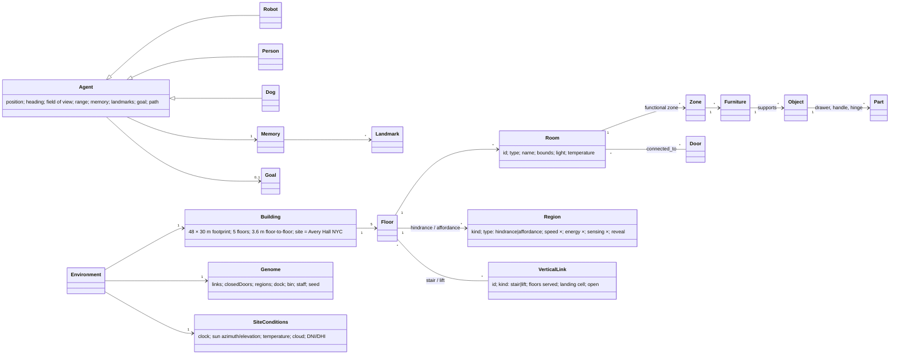
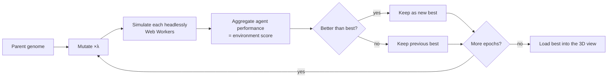

# Hearth Tower — semantic model

**Spatial idea.** A service robot (MOMO) arrives in a five-storey office it has never seen. With only its own sensors it must build a map, recognise rooms and objects, find stairs and lifts, and look after the building. Staff and an office dog share the space, each with partial knowledge and their own goals. As environment designer, you ask: *which arrangement of circulation, floor conditions and services makes all of these agents perform best?*

This file is the semantic model the simulation is built from. Code references are in brackets.

---

## 1. Entities

| Entity | Key attributes | Source |
| --- | --- | --- |
| Building / Floor | 48 × 30 m, 5 floors (L1–L5), racetrack plan: north and south corridors linked by four cross passages, a central lift core | `building.mjs` |
| Room (70) | `type` ∈ {workspace, meeting, pantry, print, reception, lounge, office, server, restroom, wellness}, interior bounds, door positions, light state, temperature | `building.mjs` `PROGRAMME` |
| Corridor / passage (30) | Type `corridor`; the circulation network | `building.mjs` |
| Door (86) | Position, swing, open / closed, the two spaces it connects | `world.mjs` |
| Window (127) | Façade side, sill, head, width (used for solar gain and glare) | `building.mjs` |
| Furniture / object (≈1,900) | Category, size, colliders, mobility (fixed / heavy / movable), affordances, parts with joints and grasp points | `catalog.mjs` |
| Vertical link (5) | West stair L1–L5, East stair L1–L5, Feature stair L1–L3, Lift 1, Lift 2 (all floors) | `building.mjs` `LINKS` |
| Region | Hindrance or affordance painted on the floor (see §5) | `env.mjs` `ZONE_KINDS` |
| Agent | Robot (1), people (4–16), dog (1) | `simulation.mjs` |
| Genome | The designer's controllable parameters (see §7) | `env.mjs` |
| Site conditions | True sun position and weather at a site clock | `realworld.mjs` |

## 2. Relations (scene graph)

`Building → Floor → Room → Zone → Furniture → Object → Part`, with edges `inside / contains`, `on_top_of`, `next_to` (gap < 0.45 m), `connected_to` (room ↔ door ↔ room), `accessible_from`, `behind` (seen from the door), `obstructed_by` (closed door, blocked interaction face), `part_of`. MOMO builds its own belief graph from observations; the ground-truth graph is only used for scoring (`semantics.mjs`).

## 3. Notions of location (frames of reference)

Every occupant has a location in each of these frames (shown live in the agent card, `metrics.mjs` `frames()`):

| Frame | Coordinates | Used by |
| --- | --- | --- |
| **World (metric)** | (x, y, z) metres; x east, z south, y = floor × 3.6 m | Physics, sensing, rendering |
| **Grid** | (i, j, floor), 1 m cells | Every planner (A*), agent memories |
| **Topological** | Floor › room / corridor | Scene graph, room recognition, staff destinations |
| **Landmark-relative** | Δ from MOMO's dock (dx, dy, dz) | MOMO's landmark memory |
| **Belief** | MOMO's estimated pose (odometry + scan matching) | The robot's own map |
| **Geographic** | Latitude, longitude, elevation (WGS84) | The real site; the building is rotated 28.9° like the Manhattan grid |

## 4. Notions of distance (metrics)

`metrics.mjs` `distances()`; shown live for the selected agent → its goal (or the dock):

| Metric | Definition | Unit |
| --- | --- | --- |
| **Euclidean 3D** | ‖p − q‖ with Δy = Δfloor × 3.6 m; ignores walls | m |
| **Grid (Manhattan)** | \|Δi\| + \|Δj\| on the 1 m grid, plus the number of floors apart | cells + floors |
| **Geodesic** | Length of the shortest walkable path through doors, stairs and lifts (A* on the true geometry) | m |
| **Travel time** | Time along that path at walking speed × region speed, plus stair climbing (1.25 m/s along the flight) and lift rides (1.6 m/s + 8 s wait) | s |
| **Topological** | Rooms entered + floors changed along the path | hops |

Planners also use a **cost metric**: 1 per cell × 1 / (region speed) for regions the agent has seen; 14 per stair flight; 8 + 3 × floors per lift ride.

## 5. Obstacles, hindrances and affordances

| Kind | Type | Effect on performance | Where it comes from |
| --- | --- | --- | --- |
| Walls, furniture, closed doors | Obstacle | Cannot be traversed (colliders, ray casts) | Building + genome `closedDoors` |
| Out-of-service stair / lift | Obstacle | Removes a vertical link | Genome `links` |
| Wet floor | Hindrance | Speed × 0.45, robot energy × 2.2 | Genome; also random spills (150 s) |
| Crowded zone | Hindrance | Speed × 0.55, energy × 1.4 | Genome |
| Works area | Hindrance | Speed × 0.35, energy × 1.8 | Genome |
| Sun glare | Hindrance | Speed × 0.8, robot camera range × 0.55 | **Real sun + weather**, recomputed every 10 site-minutes |
| Fast lane | Affordance | Speed × 1.55, energy × 0.7 | Genome |
| Charging strip | Affordance | Robot battery recharges while driving over it | Genome |
| Wayfinding sign | Affordance | Reading it adds every stair and lift on that floor to the agent's landmarks | Genome (one per lift lobby by default) |

Agents only plan around regions they have *seen* (memory cells are tagged with the region kind).

## 6. Spatial agents

| | MOMO (robot) | Staff (people) | Biscuit (dog) |
| --- | --- | --- | --- |
| Knowledge at start | Only its dock | Nothing | Nothing |
| Sensing (partial observability) | 360° LiDAR 12 m + 105° RGB-D 6.5 m, ray-cast with occlusion; detections need line of sight | 115° cone, 5 m, walls occlude | 130° cone, 4 m |
| Scanning | Turns on the spot after each goal (3.2 s) and on arrival at a new floor | Looks around while staying in a room | Same |
| Spatial memory | 0.25 m occupancy map, 1 m navigation memory, semantic belief, landmarks (dock, hubs, recycling, stair landings, lift lobbies) | 1 m cell memory, landmarks (rooms, hubs, landings) | Same as staff |
| Landmark reuse | Returns to remembered hubs, dock and recycling; counts reuses | Revisits remembered rooms | Revisits resting spots |
| Goal | Discover and complete facility tasks (litter, spills, temperature, lights, recycling, recharging) | Reach destinations (rooms they know) | Find a resting spot |
| Performance | Tasks per minute, mean task latency, coverage, energy per task, time in hindrances | Trip efficiency = ideal time ÷ actual time, failed trips, yields per minute | Trip efficiency |
| Planning ahead | A* on its own map with a footprint sweep, region costs and known links; frontier exploration; recovery | A* on its own memory with known links and region costs | Same |

## 7. Environment and its generation

| Characteristic | Choice in this model |
| --- | --- |
| Physical or abstract | **Physical** (metric 3D building) |
| Observability | **Partial** (finite cones, occlusion, unknown floors) |
| Agents | **Multi-agent** (1 robot + 4–16 people + 1 dog; one person per stair flight, one rider per lift) |
| Static or dynamic | **Dynamic**: doors open and close, furniture moves, litter appears, spills come and go, the sun moves |
| Deterministic or not | **Stochastic but seeded**: random events (litter, spills) come from the genome's seed, so a run is reproducible and two genomes are compared under the same conditions |

**Genome** (`env.mjs`): `links` (which stairs and lifts are in service), `closedDoors`, `zones` (regions), `dock`, `bin`, `staff`, `seed`. A **mutation** applies 1–3 design moves: close or reopen a link (one full-height stair always stays open), add, remove or move a region, open or close a door, move the dock or the recycling station, or change staff by ±2.

**Environment score** (0–100, `Simulation.performance()`):
`30 % robot throughput + 15 % exploration + 35 % staff flow (trip efficiency × success) + 10 % energy + 10 % calm (few yields)`.

* **Manual** (choose your own adventure): two mutations run side by side; you pick one, and two new mutations are bred from your pick; the lineage is listed.
* **Automated**: a (1 + λ) evolution strategy over *N* epochs; the chart plots the best and mean scores per epoch.

## 8. Real-world data (3D + time)

* **Place**: Avery Hall, Columbia University (40.8083° N, 73.9613° W, about 35 m above sea level). The plan is rotated 28.9° from true north, like the Manhattan street grid.
* **Time**: a site clock (any date and time, real time or accelerated).
* **Sun**: solar azimuth and elevation from astronomical formulas (declination, hour angle) give a 3D vector that places the 3D sun and its shadows.
* **Weather**: hourly temperature, cloud cover and direct-normal and diffuse irradiance from Open-Meteo (forecast API for recent days, ERA5 archive for historic dates). Without a connection, a clear-sky model is used and labelled as such.
* **Effects**: per-window solar gain sets room temperatures, which MOMO reads during temperature tasks and flags when warm. Low direct sun creates glare hindrance regions inside sunlit windows.
* The same data is also served by an MCP server (`mcp/site-data-server.mjs`).
